<a href="https://updatedportfoloiwebsite.netlify.app/">
  
</a>

  &nbsp;
  &nbsp;
  

<picture>
  <source media="(prefers-color-scheme: dark)" srcset="assets/head-about-dark.svg">
  
</picture>

I studied Computer Science and Engineering at **East West University**, Dhaka. My work sits where **machine learning, data and design** meet: I like taking a problem from its definition and the data behind it, through model building, to a result someone can actually use.

My capstone predicts Dhaka's air quality from seven IoT sensor readings with a **Random Forest**, and it now runs as a [live web app](https://airqualitypredictionapp.netlify.app/). Alongside ML, I design interfaces in Figma, build browser-based product prototypes, and most recently built a grounded RAG service that refuses to guess.

**How I work** &nbsp;`Define` → `Understand the data` → `Model` → `Evaluate` → `Deliver`

> [!TIP]
> **Open to AI/ML-focused roles**, data projects and research collaborations. Email is the quickest way to reach me.



<b>Currently exploring</b>

 

- Real-time machine learning on low-cost IoT sensor data
- End-to-end machine learning workflows, from data understanding to evaluation
- Grounded LLM answers: retrieval, citations and knowing when to say "I don't know"
- Data analysis and visualization

<picture>
  <source media="(prefers-color-scheme: dark)" srcset="assets/head-featured-dark.svg">
  
</picture>

### [Air Quality Prediction using Machine Learning and AI](https://github.com/Majortarif/Air-Quality-Prediction-using-Machine-Learning-and-AI)

  
  


| | |
|---|---|
| **Problem** | Air pollution is a major public-health risk and Dhaka regularly ranks among the most polluted cities in the world, yet real-time systems that forecast air quality accurately remain sparse. |
| **Data** | 62,188 readings from our own low-cost IoT node in Badda and Aftabnagar, Dhaka: PM2.5, PM10, NO₂, O₃, CO, temperature and humidity (PMSA003, MQ-7, MQ-131, MEMS NO₂, DHT22). |
| **Approach** | Cleaning and US EPA AQI labelling, then regression models trained and compared: Random Forest, LightGBM, KNN and SVM. |
| **Outcome** | Random Forest reached **R² 0.9933 (RMSE 3.41)** on a time-ordered held-out test. PM2.5 drives almost all of the prediction. |
| **Live app** | A real-time Dhaka dashboard: US EPA AQI gauge, the Random Forest running in the browser, 24-hour forecast, health advice and alerts, live Open-Meteo data, an ESP32 sensor mode and English/বাংলা. |

  <a href="https://airqualitypredictionapp.netlify.app/"><b>Live demo ↗</b></a> &nbsp;·&nbsp;
  <a href="https://github.com/Majortarif/Air-Quality-Prediction-using-Machine-Learning-and-AI"><b>Source ↗</b></a> &nbsp;·&nbsp;
  <a href="https://drive.google.com/drive/folders/10eSsJFSNciL62RBukbYIgn-VzT1FQ4fR"><b>Report & project files ↗</b></a>

Team of three · CSE400C capstone, East West University · Supervised by Dr. Tania Sultana

<picture>
  <source media="(prefers-color-scheme: dark)" srcset="assets/head-work-dark.svg">
  
</picture>

<a href="https://messmate-bd.netlify.app/">
  
</a>

  <a href="https://messmate-bd.netlify.app/"><b>Live app ↗</b></a> &nbsp;·&nbsp;
  <a href="https://github.com/Majortarif/messmate-bd"><b>Source ↗</b></a> &nbsp;·&nbsp;
  

<a href="https://github.com/Majortarif/docusense-rag">
  
</a>

  <a href="https://github.com/Majortarif/docusense-rag"><b>Source ↗</b></a> &nbsp;·&nbsp;
  

<a href="https://greencycle-farm.netlify.app/">
  
</a>

  <a href="https://greencycle-farm.netlify.app/"><b>Live demo ↗</b></a> &nbsp;·&nbsp;
  <a href="https://github.com/Majortarif/AgriCycle"><b>Source ↗</b></a>

<a href="https://majortarif.github.io/CareerPilot-AI-AI-Powered-Career-Skill-Intelligence-Platform/">
  
</a>

  <a href="https://majortarif.github.io/CareerPilot-AI-AI-Powered-Career-Skill-Intelligence-Platform/"><b>Live demo ↗</b></a> &nbsp;·&nbsp;
  <a href="https://github.com/Majortarif/CareerPilot-AI-AI-Powered-Career-Skill-Intelligence-Platform"><b>Source ↗</b></a>

<a href="https://icy-leaf-c41a.tariful-ewu.workers.dev/">
  
</a>

  <a href="https://icy-leaf-c41a.tariful-ewu.workers.dev/"><b>Live demo ↗</b></a> &nbsp;·&nbsp;
  <a href="https://github.com/Majortarif/ecobin-smart-waste-dashboard"><b>Source ↗</b></a> &nbsp;·&nbsp;
  <a href="https://drive.google.com/drive/folders/1W-2s4X11G8-sNc0Ek1QOp7l2QCd51YaW"><b>Concept files ↗</b></a>

<a href="https://ai-task-habit-tracker.netlify.app/">
  
</a>

  <a href="https://ai-task-habit-tracker.netlify.app/"><b>Live demo ↗</b></a> &nbsp;·&nbsp;
  <a href="https://github.com/Majortarif/ai-task-habit-tracker"><b>Source ↗</b></a>

<a href="https://github.com/Majortarif/Digital_phone_book">
  
</a>

  <a href="https://github.com/Majortarif/Digital_phone_book"><b>Source ↗</b></a>

<a href="https://drive.google.com/drive/folders/1sht8pv4eu30iUAAp8_G1_nMwnoIfspnC">
  
</a>

  <a href="https://drive.google.com/drive/folders/1sht8pv4eu30iUAAp8_G1_nMwnoIfspnC"><b>Project files ↗</b></a>

<picture>
  <source media="(prefers-color-scheme: dark)" srcset="assets/head-skills-dark.svg">
  
</picture>


  

Every skill above is used in a project on this page or listed on my CV.

<picture>
  <source media="(prefers-color-scheme: dark)" srcset="assets/head-experience-dark.svg">
  
</picture>


<picture>
  <source media="(prefers-color-scheme: dark)" srcset="assets/head-activity-dark.svg">
  
</picture>

<picture>
  <source media="(prefers-color-scheme: dark)" srcset="https://raw.githubusercontent.com/Majortarif/Majortarif/output/snake-dark.svg">
  
</picture>

Redrawn every day from my contribution graph by a GitHub Actions workflow.

<picture>
  <source media="(prefers-color-scheme: dark)" srcset="assets/head-contact-dark.svg">
  
</picture>

I'm open to AI/ML roles, data projects and research collaborations. Email is the quickest way to reach me: **[tarifulhoque347@gmail.com](mailto:tarifulhoque347@gmail.com)**

Portfolio: **[updatedportfoloiwebsite.netlify.app](https://updatedportfoloiwebsite.netlify.app/)**

  &nbsp;
  &nbsp;
  

 

<!--
  The animated SVGs in assets/ are generated by tools/build_assets.py from the
  portfolio's content and design tokens:
    python tools/build_assets.py "<path to tariful-portfolio-2026>"
  The snake is built by .github/workflows/snake.yml into the "output" branch.
-->
